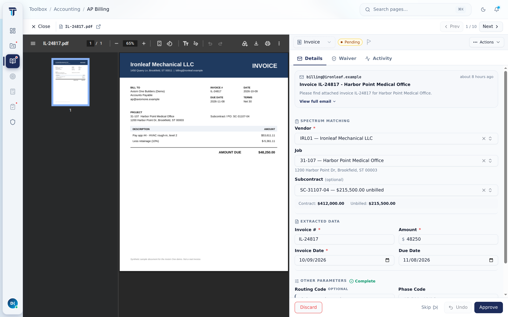
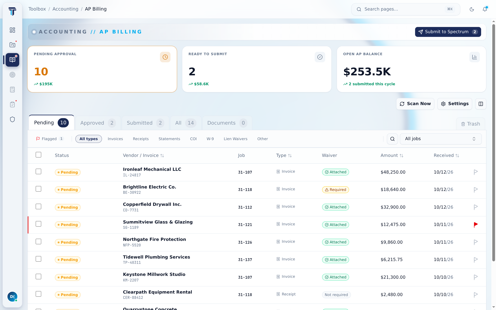
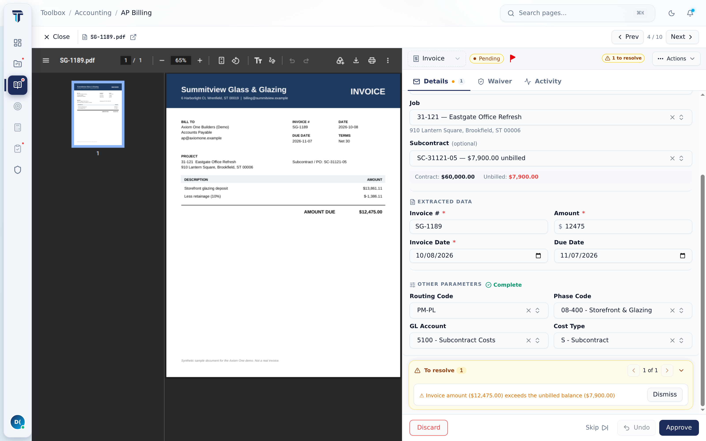
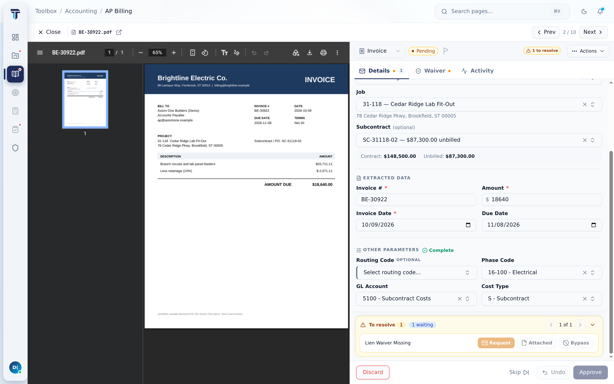
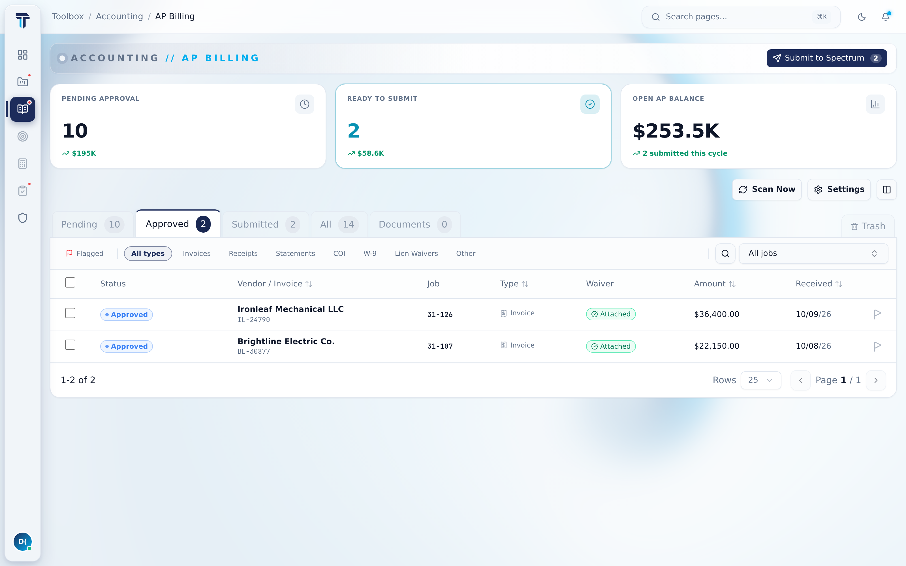

# Toolbox

Toolbox is a production AI document platform for a commercial general contractor. It reads every
invoice, lien waiver, certificate of insurance, and statement that lands in the accounting inbox. It
classifies and extracts the documents, matches them to jobs and subcontracts in the ERP, and routes
them through approval. Approved documents are filed to SharePoint and submitted to the accounting
system.

This repository is a **public portfolio snapshot** of the production codebase. It has a fresh
history and every company, person, vendor, job, and address in it is invented (see
[About this snapshot](#about-this-snapshot)).



| | |
|---|---|
|  |  |
| **AP queue.** Pending invoices with vendor, job, type, and waiver status. | **Over-budget routing.** An invoice that exceeds the subcontract's unbilled balance is routed to the PM. |
|  |  |
| **Lien waiver gate.** Approval is blocked until a matching waiver is on file. | **Approved queue.** Approved invoices ready for submission to the ERP. |

*Screenshots of the running app in demo mode. Every vendor, job, invoice, and document shown is invented.*

## What it does

- **Ingests email.** Polls a shared mailbox through Microsoft Graph, pulls attachments, and splits
  multi-document PDFs into individual documents.
- **Classifies and extracts.** An LLM vision pass labels each page (invoice, pay app, lien waiver,
  COI, W-9, statement, and more), then pulls typed fields per document type.
- **Matches to the ERP.** Resolves vendor, job, subcontract, phase, and cost type against the
  accounting system, using subject-line job references, learned sender domains, and fuzzy matching.
- **Enforces compliance.** Lien-waiver gates block approval until a matching waiver is on file.
  COI checks compare coverage, limits, and certificate holder against configurable rules.
- **Approves, files, and submits.** Role-gated approval queues with audit trails and undo, best-effort
  SharePoint filing, and idempotent submission to the ERP with recovery on partial failure.
- **Collaboration.** Per-document comments, activity feeds, read state, and email threads tied to
  the document they concern.

## Architecture

```
apps/
├── api/        Express API + pipeline workers (Node.js, Postgres via Supabase)
│   ├── modules/invoices/   routes → services → db; pipeline, matcher, extractor, COI engine
│   ├── middleware/         auth, permissions, rate limiting, response finalizer
│   ├── migrations/         dated SQL migrations with rollbacks
│   └── tests/              node:test suites (security boundaries, pipeline, approvals)
└── web/        Next.js 16 + React 19 frontend (TypeScript, TanStack Query/Table, Tailwind)
    └── src/modules/        accounting/invoices, projects, platform-admin, shared
test-fixtures/  cross-app contract fixtures shared by both test suites
```

Engineering rules the codebase enforces on itself, with tests:

- Every API route carries a handler-level permission check; a static test fails the build otherwise.
- Routes are transport-only. ESLint import boundaries keep database access in services.
- Every mutation emits an actor-attributed audit event. The server, not the client, sets the actor.
- Error responses share one shape (`{ error, code?, details? }`), enforced at emission time by
  `middleware/responseFinalizer.js`.
- List endpoints use bounded, keyset-friendly pagination.

See `apps/api/docs/ENDPOINT-STANDARD.md`, `apps/api/ARCHITECTURE.md`, and
`apps/web/docs/MODULE-CONTRACT.md` for the full contracts.

## Running the tests

Requires Node.js 22 or newer. No database or cloud credentials are needed; external services are
mocked.

```bash
cd apps/api && npm ci && npm test      # lint + ~1,200 backend tests
cd apps/web && npm ci && npx vitest run  # ~2,300 frontend tests
```

## About this snapshot

- **Fresh history.** The production repository has 1,500+ commits. This snapshot is a single
  squashed import of the current code. Internal agent logs, audit reports, and build artifacts were
  left out.
- **Invented data.** The operating company appears as the fictional *Northwind Contracting Group*
  (`northwindcg.example`). Employees, vendors, customers, jobs, addresses, phone numbers, and IDs in
  mocks, fixtures, and tests are synthetic.
- **Not deployable as-is.** Tenant IDs, mailbox addresses, and integration endpoints are
  placeholders. Configuration comes from environment variables (`apps/api/.env.example`).

## License

[MIT](LICENSE)
